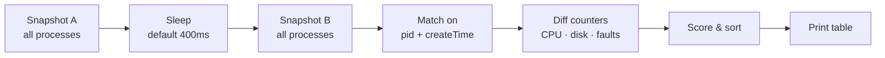

# hog

A small Windows command-line tool that shows which processes are slowing your machine down right now.

It exists because Task Manager can take a while to open when a machine is already struggling, and by the time it appears the slowdown has often passed. hog takes two quick snapshots of every process, works out what changed in between, and prints a short table. It usually has an answer within half a second.

About 45 KB, no admin rights needed, runs on Windows 7 and later.

## 📦 Install

Paste this into PowerShell:

```powershell
irm https://raw.githubusercontent.com/markcastle/hog/master/install.ps1 | iex
```

This downloads the latest `hog.exe` to `%LOCALAPPDATA%\hog` and adds that folder to your user PATH. Run the same line again to upgrade. Nothing is changed system-wide.

If you'd rather do it by hand, download `hog.exe` from the [latest release](https://github.com/markcastle/hog/releases/latest) and put it anywhere on your PATH.

---

## ⚡ Quick start

### 1. Get it

See [Install](#-install) above, or build it yourself:

```bat
:: MSVC (Developer Command Prompt)
cl /O2 /MT src\hog.c

:: MinGW
x86_64-w64-mingw32-gcc -O2 -s -o hog.exe src/hog.c
```

### 2. Run it when things feel slow

```bat
hog
```

You get the top 10 processes ranked by a combined impact score. Most of the time that's all you need.

### 3. Look closer if you need to

```bat
hog -w              :: live view, refreshes in place, Ctrl+C to quit
hog -d -n 20        :: top 20 by disk throughput
hog -i 1000         :: sample for a full second instead of 400ms
hog -c              :: sort by CPU
hog -f              :: sort by hard page faults
hog -m              :: sort by private memory
```

Tip: if something is going wrong and you don't have time to look, `hog -n 50 > snapshot.txt` captures the moment so you can read it later.

---

## 👀 What you're looking at

```
sampled 0.40s over 16 logical CPUs   cpu 62.3%   dpc 1.1%   isr 0.4%

    PID   CPU%  DISK MB/s      IO/s  HARDFLT/s   PRIV MB   THR  NAME
   9184   41.2       0.03         7          0     812.4    48  chrome.exe
   4012    2.1      58.70      1420          0      95.2    12  MsMpEng.exe
```

### The header

| Field | Meaning |
| --- | --- |
| `cpu` | How busy the whole machine was during the sample |
| `dpc` / `isr` | Kernel time spent in driver interrupt work. This belongs to no process, so it never shows up in the table |

If `dpc` or `isr` goes above about 8%, hog prints a note. In that situation the process list won't help much; the likely cause is a driver.

### The columns

Almost every column is a rate over the sample window, not a lifetime total. `PRIV MB` is the exception, it's the current value. This matters because a process with a large lifetime CPU figure in Task Manager can be completely idle right now.

| Column | Meaning |
| --- | --- |
| `CPU%` | Share of the machine's CPU this process used during the sample |
| `DISK MB/s` | Disk bytes read and written, as MB/s |
| `IO/s` | Disk I/O operations per second |
| `HARDFLT/s` | Hard page faults per second (reads from the pagefile) |
| `PRIV MB` | Private memory right now |
| `THR` | Thread count |
| `NAME` | Process image name |

`HARDFLT/s` is worth a look when CPU is modest but the machine feels unresponsive. That pattern often means it's thrashing the pagefile.

---

## 🧠 How it works



A single `NtQuerySystemInformation(SystemProcessInformation)` call returns every process with its CPU times, I/O counts, page faults and memory. There's no `OpenProcess` per PID, so protected processes don't cause errors and the tool doesn't add much load to a machine that's already struggling.

Processes are matched between snapshots on `(pid, createTime)` rather than PID alone. Windows reuses PIDs, and this avoids attributing a finished process's counters to whatever got the same number next.

hog raises its own priority to `HIGH_PRIORITY_CLASS` so it still gets scheduled when something else is using all the CPU.

> The ntdll structs hog reads aren't in the public SDK, but their layout has been stable since Windows 7. If a future Windows release changes them, the symptom would be obviously wrong numbers rather than a crash.

---

## 🎯 The impact score

The default sort uses a simple heuristic whose only job is to put the most likely culprit at the top.

```text
score = cpuPct
      + min(150, diskMBps * 2)
      + min(150, hardFaults / 10)
```

In practice this means roughly 50 MB/s of sustained disk, or about 1000 hard faults per second, each count for about as much as one fully busy core.

If the weights don't suit your machine, they're a two-line change in `impact_score()`.

---

## ⌨️ Flags

| Flag | Default | Meaning |
| --- | --- | --- |
| `-n TOP` | `10` | How many rows to print |
| `-i MS` | `400` | Sample interval in ms (minimum 50) |
| `-w` | off | Live view, refreshes in place until Ctrl+C |
| `-c` | | Sort by CPU |
| `-d` | | Sort by disk throughput |
| `-f` | | Sort by hard page faults |
| `-m` | | Sort by private memory |
| `-v` | | Print version and exit |

With no sort flag, hog sorts by the combined impact score.

---

## 🚫 What hog doesn't do

- **Kill processes.** It shows you what's happening; what to do about it is your call. `taskkill` is right there if you need it.
- **Show a UI.** It's a command-line tool so it can be piped, redirected and run in scripts.
- **Cover network I/O.** That needs different APIs and a fair bit more code. Disk and CPU cover most "why is this slow?" cases.

---

## ✅ Requirements

- Windows 7 or later (x86 or x64)
- No admin rights needed
- No dependencies beyond the standard Windows headers
- The binary is around 45 KB

---

## 🧩 Ideas for later

- Log mode: append a CSV row every N seconds, for slowdowns that happen when nobody's watching
- Machine-level memory pressure (commit charge, file cache), not just per-process
- `-t PID` thread drill-down (the thread data is already in the buffer; hog currently ignores it)
